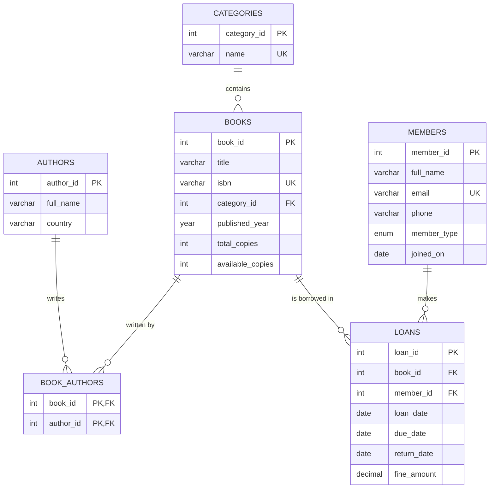
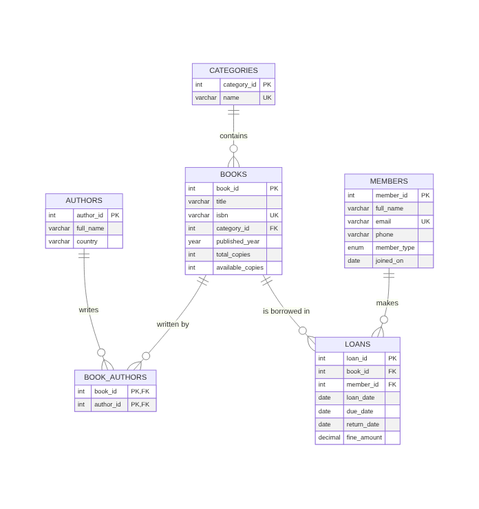
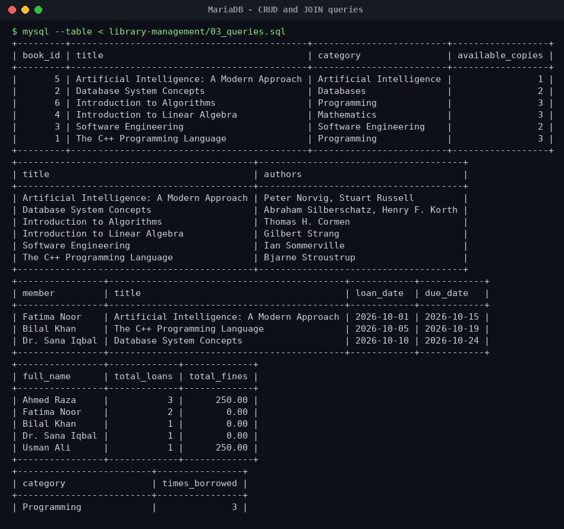
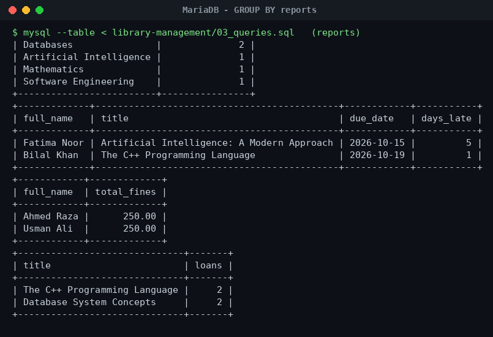

# Database Management System — Library Management (MySQL)


Database Systems (Theory + Lab) coursework. I designed a relational database for a **university library**: books, authors, categories, members and loans — with primary and foreign keys, constraints, sample data, CRUD statements, JOINs, GROUP BY reports, views and subqueries. The `db-lab-exercises/` folder holds my weekly SQL lab practice on the same database.

## ER diagram





**Relationships**

- A **category** has many books (1 : N), `ON DELETE SET NULL`
- A **book** can have many authors and an **author** many books (M : N through `book_authors`)
- A **member** makes many **loans**, and every loan refers to one book (1 : N)

## Project structure

```
library-management/
├── 01_schema.sql        # CREATE DATABASE + tables, PK/FK, UNIQUE, CHECK, indexes
├── 02_seed_data.sql     # sample categories, authors, books, members, loans
├── 03_queries.sql       # CRUD, JOINs, GROUP BY / HAVING, subquery reports
└── 04_views.sql         # active_loans and book_availability views
db-lab-exercises/
├── lab-01-basic-select.sql   # SELECT, WHERE, LIKE, ORDER BY, LIMIT
├── lab-02-constraints.sql    # what each constraint prevents (+ ON DELETE SET NULL demo)
├── lab-03-joins.sql          # INNER / LEFT joins, self-join on loans
├── lab-04-aggregates.sql     # COUNT, SUM, AVG, MIN, MAX, HAVING
└── lab-05-subqueries.sql     # IN, NOT IN, EXISTS, scalar subquery
run_all.sh                    # builds the database and runs every file
```

## How to run

```bash
# MySQL / MariaDB must be installed
./run_all.sh                       # asks for the root password
# or, on Linux with socket auth:
MYSQL="sudo mysql" ./run_all.sh
```

Or file by file:

```bash
mysql -u root -p < library-management/01_schema.sql
mysql -u root -p < library-management/02_seed_data.sql
mysql -u root -p --table < library-management/03_queries.sql
```

## Example reports

| Report | SQL features |
|---|---|
| Books with all their authors | 3-table JOIN, `GROUP_CONCAT` |
| Books currently on loan and who has them | JOIN + `WHERE return_date IS NULL` |
| Members who never borrowed anything | `LEFT JOIN … IS NULL` |
| Loans and total fines per member | `GROUP BY`, `COUNT`, `SUM` |
| Most borrowed categories | JOIN + `GROUP BY` + `ORDER BY` |
| Overdue loans and days late | `DATEDIFF` |
| Books borrowed more than average | `HAVING` with a nested subquery |

## Output screenshots





## What I learned

- Normalising data into separate tables and linking them with foreign keys
- Using a junction table for a many-to-many relationship
- How `CHECK`, `UNIQUE` and `ON DELETE` rules protect the data
- Writing reports with JOIN, GROUP BY, HAVING and subqueries

## Author

**Dheya Alhag** — BS Software Engineering, Superior University, Lahore
GitHub: [@dhiaalhaq7979](https://github.com/dhiaalhaq7979)
